<!-- Banners: `pnpm build` (content in assets/scripts/data.mjs) · Recordings of the portfolio: `pnpm record` -->

<a href="https://zabdielportfolio.vercel.app"><picture><source media="(prefers-color-scheme: dark)" srcset="./assets/hero-dark.svg" />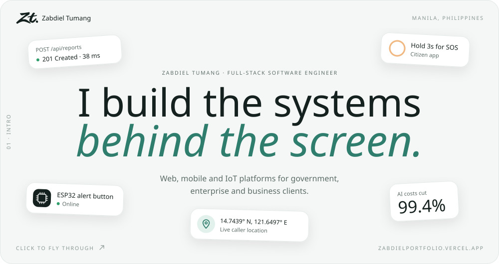</picture></a>

  <a href="https://zabdielportfolio.vercel.app"><picture><source media="(prefers-color-scheme: dark)" srcset="./assets/btn-portfolio-dark.svg" /></picture></a>
  <a href="https://www.linkedin.com/in/zabjt/"><picture><source media="(prefers-color-scheme: dark)" srcset="./assets/btn-linkedin-dark.svg" /></picture></a>
  <a href="mailto:zabdieljairus@gmail.com"><picture><source media="(prefers-color-scheme: dark)" srcset="./assets/btn-email-dark.svg" /></picture></a>
  <a href="https://www.instagram.com/zab.jt/"><picture><source media="(prefers-color-scheme: dark)" srcset="./assets/btn-instagram-dark.svg" /></picture></a>

<a href="https://zabdielportfolio.vercel.app">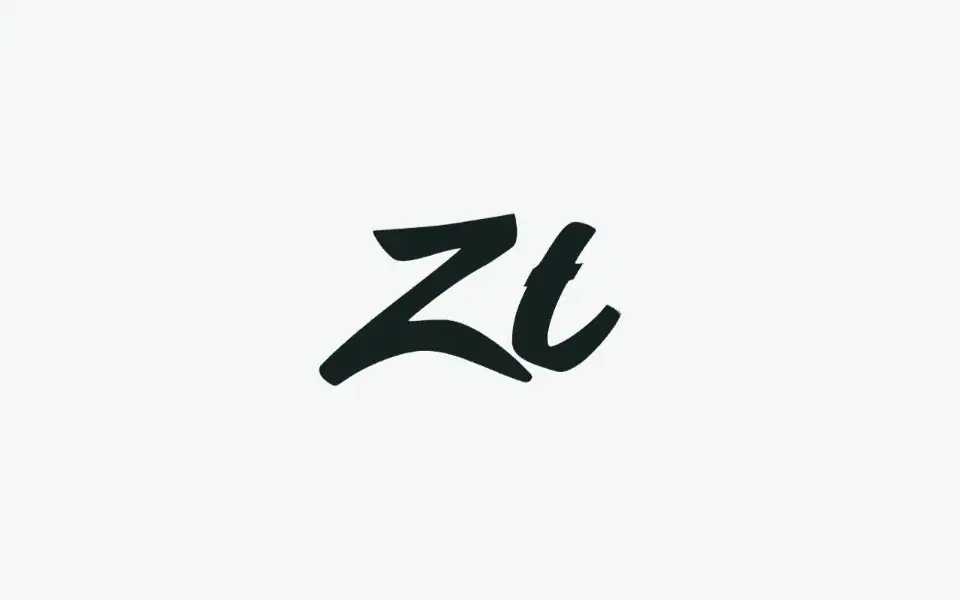</a>

The welcome and the fly-in, recorded from <a href="https://zabdielportfolio.vercel.app">the portfolio</a>.

<picture><source media="(prefers-color-scheme: dark)" srcset="./assets/skills-dark.svg" />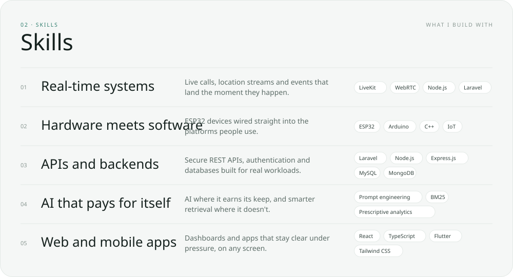</picture>

<a href="https://zabdielportfolio.vercel.app"><picture><source media="(prefers-color-scheme: dark)" srcset="./assets/work-dark.svg" />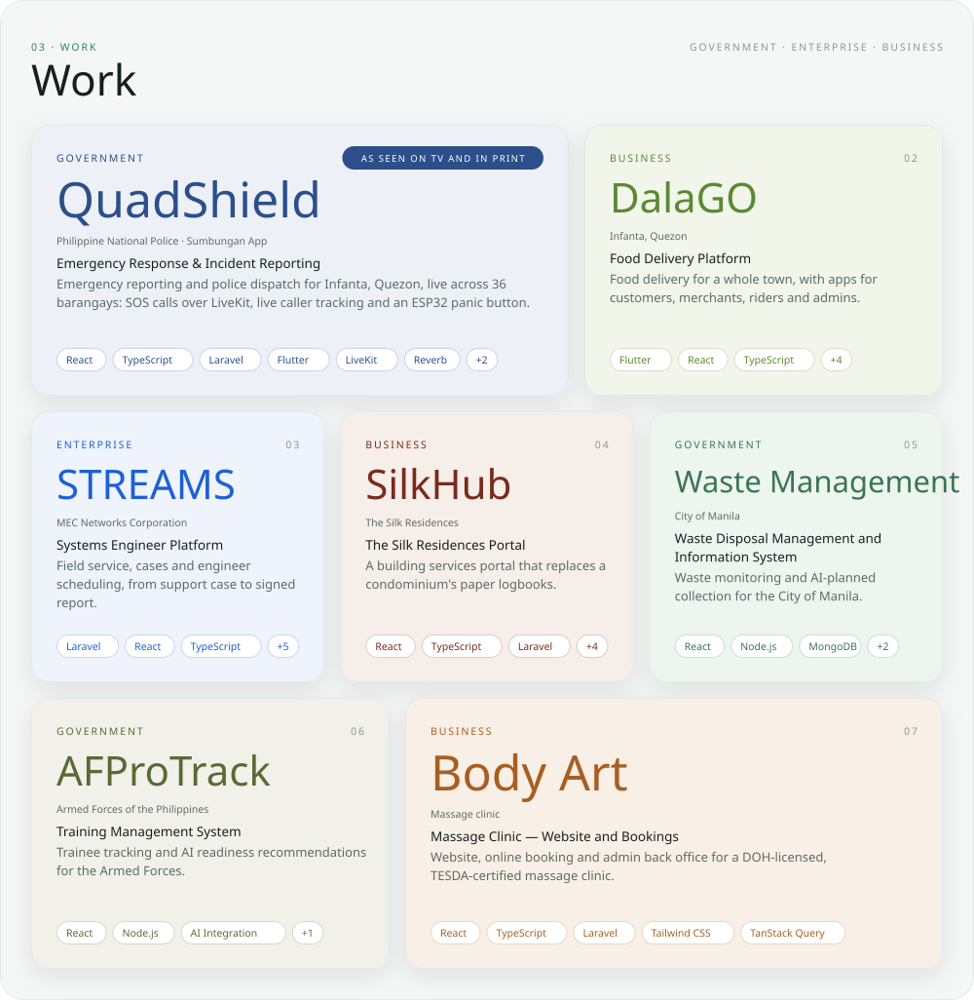</picture></a>

<b>Every project, in one line</b>

 

| | Project | What it is |
| :-- | :-- | :-- |
| 01 | **QuadShield** | Emergency reporting and police dispatch for Infanta, Quezon, live across 36 barangays: SOS calls over LiveKit, live caller tracking and an ESP32 panic button. Covered by [Pilipino Star Ngayon](https://www.philstar.com/pilipino-star-ngayon/probinsiya/2026/09/01/2553184/sumbungan-app-ng-infanta-police-inilunsad) and [Sentinel Times](https://www.sentineltimes.net/2026/09/gps-based-sumbungan-app-launched-for.html). |
| 02 | **DalaGO** | Three Flutter apps from one monorepo for customers, merchants and riders, with a React console, server-priced delivery fees and timed rider offers. |
| 03 | **STREAMS** | MEC's field service platform, co-developed by three: job orders, live engineer tracking, signed site reports, 11 role types and four synced systems. |
| 04 | **SilkHub** | Lobby QR registration, a live guard queue with 400 numbered visitor tags, and guest pre-registration up to 30 days ahead. |
| 05 | **Waste Management** | Waste monitoring for Manila's Department of Environment and Public Services, with weather-aware AI collection strategies. |
| 06 | **AFProTrack** | Personnel and trainee tracking for the Armed Forces, with AI readiness analysis and targeted training recommendations. |
| 07 | **Body Art** | Website, online booking and admin back office for a DOH-licensed, TESDA-certified massage clinic. |

<picture><source media="(prefers-color-scheme: dark)" srcset="./assets/showcase-dark.svg" /></picture>

<a href="https://zabdielportfolio.vercel.app">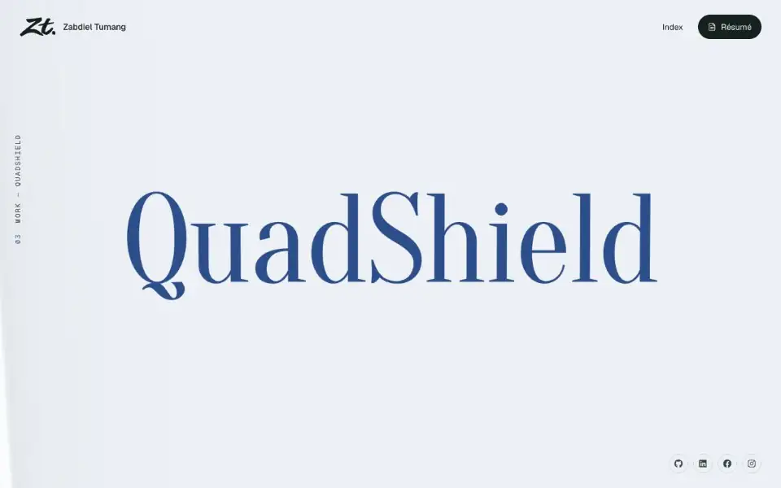</a>

<b>QuadShield</b> · An SOS call with live location, from a citizen's phone to the officer on duty.

<a href="https://zabdielportfolio.vercel.app">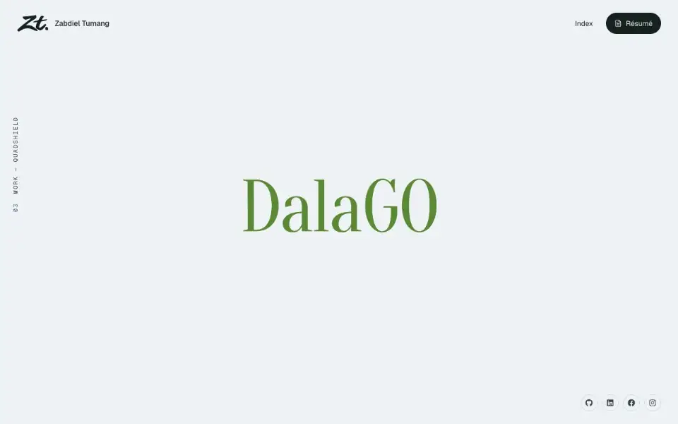</a>

<b>DalaGO</b> · Food delivery for a whole town, with apps for customers, merchants, riders and admins.

<a href="https://zabdielportfolio.vercel.app">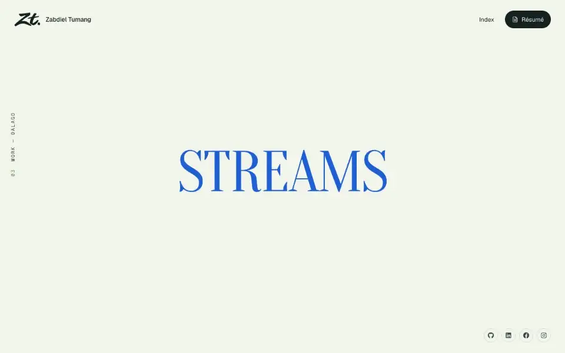</a>

<b>STREAMS</b> · Field service, cases and engineer scheduling, from support case to signed report.

<b>SilkHub</b> · A building services portal that replaces a condominium's paper logbooks.

<picture><source media="(prefers-color-scheme: dark)" srcset="./assets/about-dark.svg" />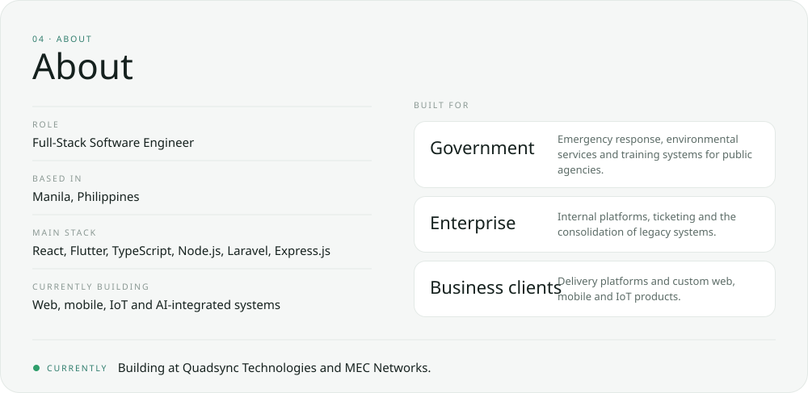</picture>

<picture><source media="(prefers-color-scheme: dark)" srcset="./assets/principles-dark.svg" />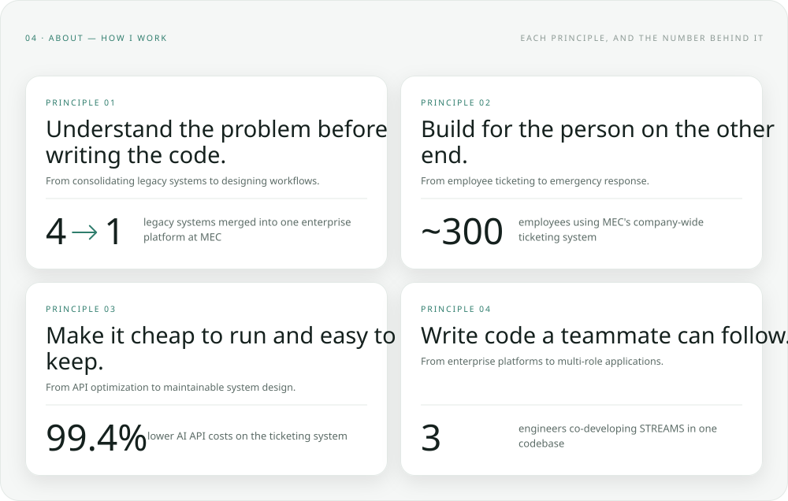</picture>

<picture><source media="(prefers-color-scheme: dark)" srcset="./assets/stack-dark.svg" />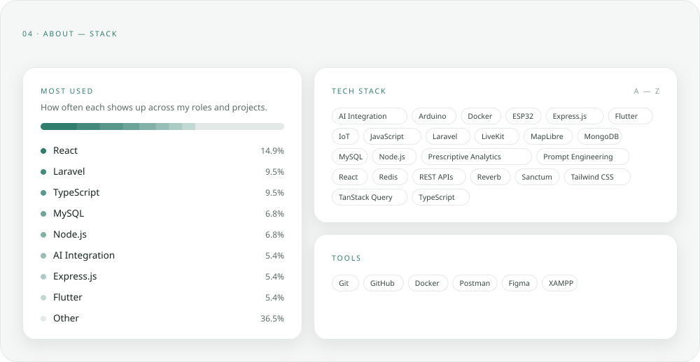</picture>

<picture><source media="(prefers-color-scheme: dark)" srcset="./assets/experience-dark.svg" />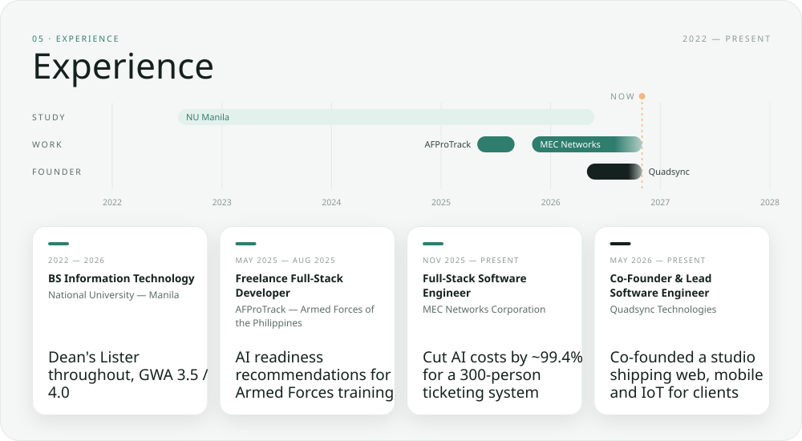</picture>

<a href="https://zabdielportfolio.vercel.app">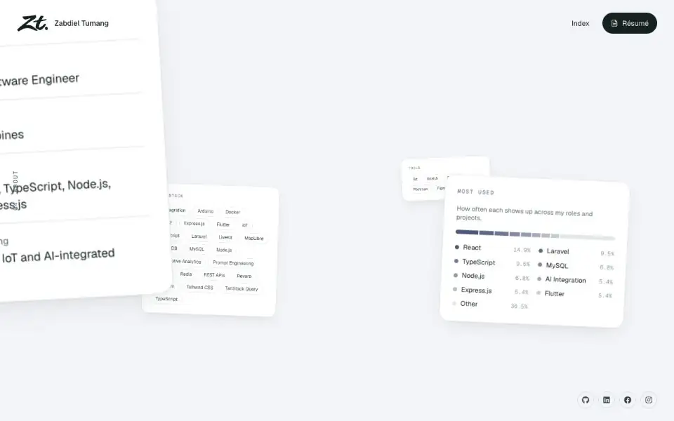</a>

The years fly past, one role at a time.

<picture><source media="(prefers-color-scheme: dark)" srcset="./assets/activity-dark.svg" /></picture>

  <picture>
    <source media="(prefers-color-scheme: dark)" srcset="https://github-readme-stats-topaz-tau-50.vercel.app/api?username=zabjt&show_icons=true&count_private=true&include_all_commits=true&hide=stars&line_height=30&card_width=495&border_radius=18&bg_color=0E1513&title_color=E8EEEB&text_color=93A29D&icon_color=6CC2AD&border_color=25312D" />
    
  </picture>
  <picture>
    <source media="(prefers-color-scheme: dark)" srcset="https://streak-stats.vercel.app/?user=zabjt&border_radius=18&background=0E1513&border=25312D&stroke=25312D&ring=6CC2AD&fire=F2B880&currStreakNum=E8EEEB&sideNums=E8EEEB&currStreakLabel=6CC2AD&sideLabels=93A29D&dates=6B7B75" />
    
  </picture>

<a href="mailto:zabdieljairus@gmail.com"><picture><source media="(prefers-color-scheme: dark)" srcset="./assets/contact-dark.svg" />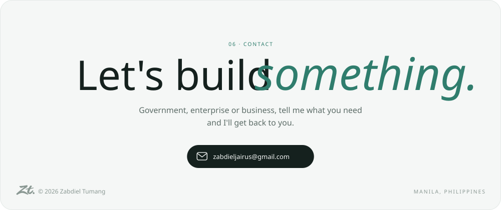</picture></a>

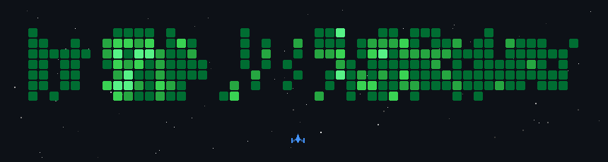

My contribution graph as a space shooter, redrawn every day.

